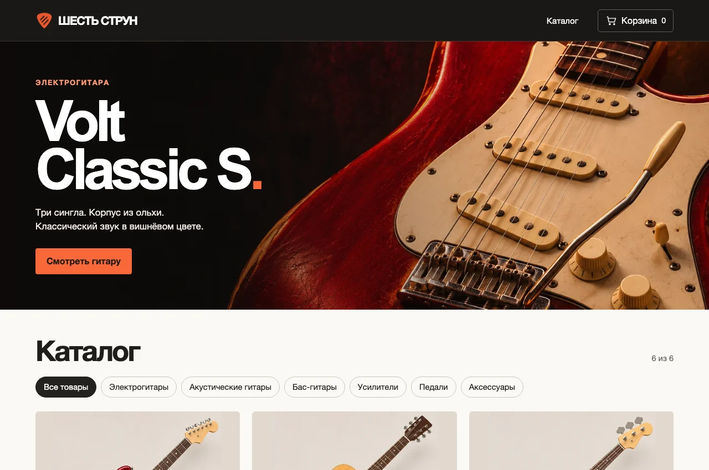

# Проверка магазина перед защитой

## Сквозной сценарий

Откройте магазин и зарегистрируйте двух покупателей с разными учебными адресами почты. Для переключения используйте кнопку «Выйти из аккаунта» в профиле.

| Проверка | Действие | Ожидаемый результат |
| --- | --- | --- |
| Гость | Открыть карточку, нажать «Войти, чтобы добавить» | Появляется форма входа, после входа открывается выбранная карточка |
| Корзина первого аккаунта | Добавить две упаковки Amber Picks 0,88 мм и обновить страницу | В корзине 2 упаковки, сумма 900 ₽ |
| Разделение данных | В том же браузере выйти и зайти под вторым аккаунтом | Личные корзина и история второго покупателя пусты |
| Возврат | Войти под первым аккаунтом | Обе упаковки снова в корзине |
| Заказ | Заполнить тестовые контакты и выбрать курьера | Сервер сохраняет заказ на 1 400 ₽ и очищает корзину первого аккаунта |
| Оплата | Подтвердить демо-оплату, обновить страницу | Виден прежний номер заказа и подтверждённый статус |
| Чужая квитанция | Скопировать адрес заказа первого покупателя и открыть под вторым аккаунтом | «Заказ не найден». История второго аккаунта не показывает эту покупку |

## Автоматическая проверка

`npm test` запускает тесты Django на отдельной тестовой базе. Проверяются регистрация, пароль, CSRF, выход и завершение сессии, смена аккаунта, количество и варианты, доступ к заказам, повтор оформления, расчёт на сервере и сохранность корзины при ошибке. Для повторения теста из терминала Python выполните `.venv/bin/python manage.py test server`.
